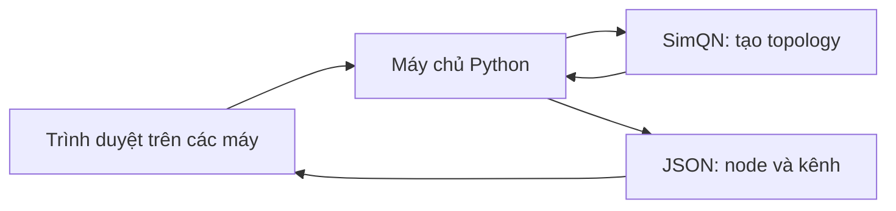
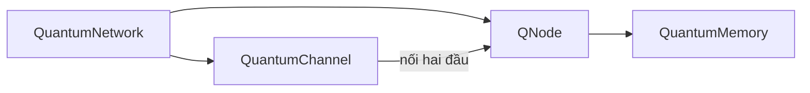

# SimQN Network Explorer

Trang demo một màn để tạo và khám phá cấu trúc mạng bằng **SimQN thật** trong thư mục `qns` của repository này. Không xuất mã, không cần tài khoản và không dùng dịch vụ ngoài.

- Tạo 2–1.000 node với RandomTopology, GridTopology, TreeTopology, LineTopology.
- Quan sát kênh lượng tử, phóng to, kéo sơ đồ, bật tên node.
- Chọn node trên sơ đồ hoặc bằng danh sách; xem bộ nhớ, số kênh, node lân cận, độ trễ và băng thông kênh.
- Số liệu lấy từ các đối tượng SimQN vừa khởi tạo. Vị trí node chỉ là bố cục hiển thị, không phải tọa độ vật lý.
- Truyền qubit từ A đến B bằng Simulator, QuantumChannel.send và RecvQubitPacket của SimQN; mỗi request gửi một qubit độc lập ở trạng thái |0⟩.
- Chọn số kênh của mạng ngẫu nhiên, số request, tốc độ gửi, băng thông, độ trễ và tỷ lệ mất trên mỗi kênh. Kết quả gồm đường đi, số gửi/nhận/mất theo từng chặng và thời điểm sự kiện cuối.
- Bộ nhớ được khởi tạo nhưng chưa tham gia lưu qubit. Đây là chuyển tiếp qubit lý tưởng qua từng kênh, chưa có giao thức rối lượng tử, teleportation hoặc đánh giá fidelity. Giới hạn 1.000 node thuộc bản demo, không phải giới hạn thư viện.

## Chạy trên Windows, macOS hoặc Linux

Cần Python 3.12 trở lên. Chạy từ thư mục gốc repository.

Windows:

```powershell
python -m venv env
.\env\Scripts\python.exe -m pip install -r web_demo/requirements.txt
.\env\Scripts\python.exe web_demo/server.py
```

macOS / Linux:

```sh
python3 -m venv env
env/bin/python -m pip install -r web_demo/requirements.txt
env/bin/python web_demo/server.py
```

Mở http://127.0.0.1:8000 trong trình duyệt. Không cần Node.js hay bước build giao diện. Toàn bộ tài nguyên giao diện được phục vụ từ máy chủ, không phụ thuộc CDN.

## Dùng từ nhiều máy

Trên máy phục vụ, thêm `--host 0.0.0.0` vào lệnh chạy, ví dụ:

```powershell
.\env\Scripts\python.exe web_demo/server.py --host 0.0.0.0 --port 8000
```

Các máy cùng mạng mở `http://<IP-máy-phục-vụ>:8000`. Cho phép cổng 8000 qua tường lửa của máy phục vụ nếu cần. Các lần tạo mạng độc lập; thay đổi trên trình duyệt này không ghi đè mạng đang xem trên trình duyệt khác.

Hoặc dùng Docker, từ thư mục gốc repository:

```sh
docker build -f web_demo/Dockerfile -t simqn-demo .
docker run --rm -p 8000:8000 simqn-demo
```

Máy chủ này dành cho demo trên máy cá nhân hoặc mạng nội bộ tin cậy. Không có xác thực, lưu trữ lâu dài hay giới hạn truy cập; để đưa lên Internet cần lớp phục vụ có HTTPS, xác thực và giới hạn yêu cầu.

## Cấu trúc



Quan hệ giữa các đối tượng thật của thư viện:



`server.py` phục vụ API và ba tệp giao diện trong `static/`. API kiểm tra kiểu mạng, số node, bộ nhớ và độ trễ trước khi gọi SimQN. Mạng ngẫu nhiên mặc định dùng `2 × số node` kênh, cho chỉnh từ `số node − 1` đến số cặp node có thể nối, tối đa 6.000 kênh. Tất cả node liên thông; số kênh không phải số node lân cận cố định của mỗi node. Cây dùng hai node con cho mỗi node cha. Lưới yêu cầu số node là số chính phương. Băng thông mặc định là 1.000 qubit/s. Các thuộc tính kênh áp dụng đồng đều cho toàn mạng. Sau khi đổi cấu hình, nhấn Tạo mạng để áp dụng; truyền qubit luôn dùng cấu hình và seed của mạng đang hiển thị.

Đường truyền dùng BFS để chọn đường ít chặng nhất vì các kênh có cùng trọng số. Mỗi lượt gửi tối đa 1.000 request và 100.000 lần truyền qua kênh. Máy chủ chạy đến khi hết sự kiện; số mất là số gửi trừ số đến đích. Thời điểm sự kiện cuối tính từ lúc gửi qubit đầu tiên, bao gồm thời gian chờ băng thông; không phải thời gian chạy thực tế trên máy. Tạo lại cùng cấu hình và seed giữ nguyên mạng, giúp nhiều trình duyệt dùng độc lập mà không cần lưu phiên trên máy chủ.

## Kiểm tra

```powershell
.\env\Scripts\python.exe -m unittest web_demo.test_demo -v
```

Trên macOS/Linux thay đường dẫn Python bằng `env/bin/python`. Bộ kiểm tra gồm bốn topology, mạng 1.000 node, thuộc tính thật, yêu cầu đồng thời, cấu hình sai, API HTTP, truyền nhiều chặng, hàng đợi băng thông, mất 100%, độ trễ bằng 0 và tái tạo đúng mạng đang hiển thị.

Màu và font khai báo ở đầu `static/style.css`. Giao diện dùng nền sáng, màu nhấn xanh lá và font hệ thống dự phòng để chạy ngoại tuyến; chưa có chế độ tối.


## Cách đọc thời gian truyền

- **Tổng thời gian truyền tin:** từ request đầu tại A (t = 0) đến sự kiện gửi/nhận cuối. Khi không mất qubit, đó cũng là thời gian nhận đủ toàn bộ qubit tại B. Nếu có mất qubit, chỉ là thời gian kết thúc lượt chạy; demo không gửi lại.
- **Khoảng phát request:** `(N − 1) / tốc độ gửi` giây, vì request đầu được phát ở t = 0. Đây là lúc đưa qubit vào kênh, chưa đảm bảo kênh đã gửi ngay nếu đang bận.
- **Độ trễ đường đi:** tổng độ trễ các kênh trên đường A → B, chưa gồm thời gian chờ băng thông. Các request truyền chồng thời gian, nên không nhân độ trễ này với N.
- **Đầu tiên/cuối cùng đến B:** các mốc nhận đo từ t = 0, chỉ xét qubit nhận thành công. Không có qubit đến B thì trả về null và hiển thị rõ điều đó.
- **Thời gian A → B trung bình:** trung bình hiệu giữa mốc nhận tại B và mốc phát request tại A, chỉ trên các qubit nhận được.
- **Chờ kênh trung bình:** thời gian A → B trung bình trừ độ trễ đường đi. Mô hình hiện tại chuyển tiếp ngay tại node trung gian và không lưu bộ nhớ, nên phần dư này là thời gian chờ băng thông.
- **Thời gian chạy thực tế:** đo bằng đồng hồ máy chủ quanh vòng lặp Simulator.run. Không cộng số này vào thời gian truyền; không gồm tạo mạng, tìm đường, chờ khóa, HTTP hoặc hiển thị.

Ví dụ kiểm thử: 10 request, 100 qubit/s, đường 4 chặng × 10 ms, băng thông 1.000 qubit/s, mất 0%. Khoảng phát là 90 ms, độ trễ một qubit là 40 ms, qubit đầu đến ở 40 ms và qubit cuối đến ở 130 ms. Tổng thời gian truyền là 130 ms; thời gian A → B trung bình là 40 ms, chờ kênh trung bình là 0 ms.

SimQN hiện dùng băng thông để giới hạn khoảng cách giữa hai lần gửi trên cùng kênh, không cộng thêm `1 / băng thông` vào thời gian đến của qubit đầu tiên. Độ phân giải mô phỏng là 1 microsecond (0,001 ms). Các chỉ số thời gian hiển thị tối đa ba chữ số thập phân.
